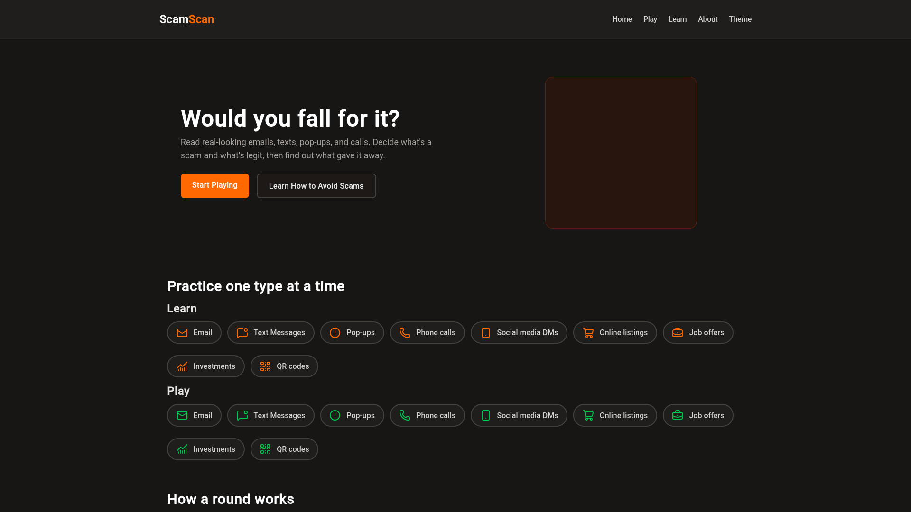
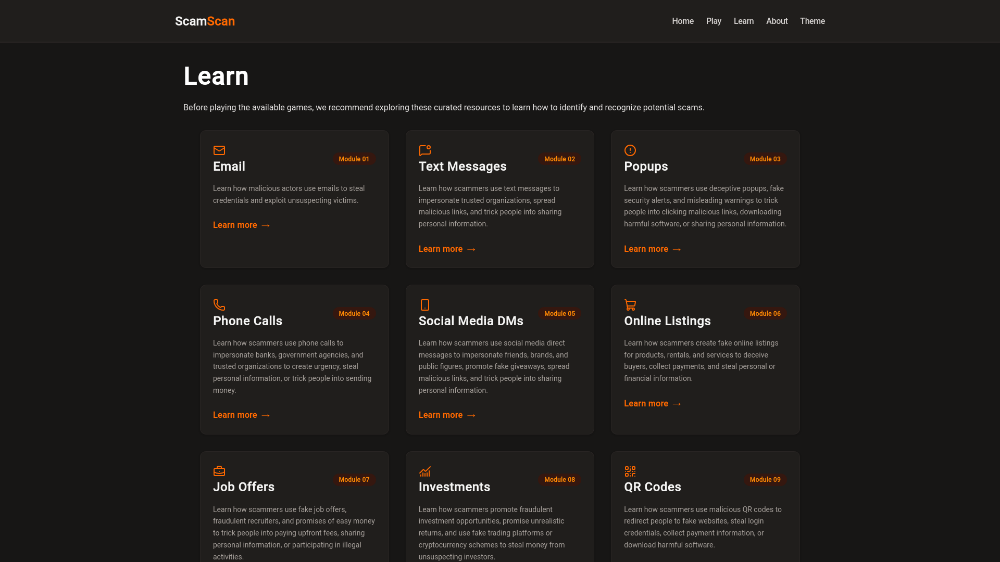
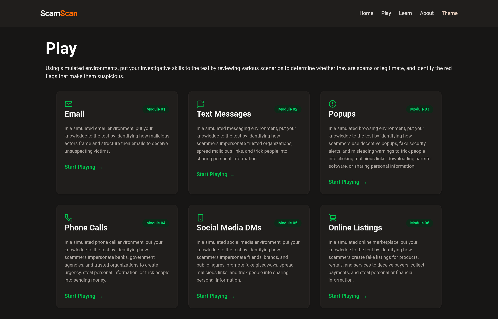

# ScamScan

## Project Overview

ScamScan is a centralized, easy-to-understand, and gamified educational platform designed to teach users how scammers deceive and manipulate people into disclosing personal, private, and sensitive information.

Through interactive learning resources, educational content, and activities, ScamScan aims to help users recognize common scams, understand the techniques scammers use, and better protect themselves online.

Users can put their existing or newly acquired knowledge to the test through interactive games designed to simulate realistic situations. Rather than relying solely on traditional multiple-choice quizzes, these activities place users in familiar, scenario-based environments where they must assess situations and make decisions as they would in real life.

For example, users may be presented with an email in an interface resembling a traditional email client and asked to determine whether it is legitimate or potentially malicious. This approach encourages users to apply their knowledge in practical situations rather than simply recall information.

ScamScan is a school project developed as part of a Web Development course. Its purpose is to demonstrate an understanding of the tools, concepts, and processes involved in designing, developing, and testing a website. Please note that the project may not receive ongoing maintenance or updates after the course has concluded.

## Features

- **Educational Resources:** A collection of curated resources to help users understand common scams and recognize suspicious activity.
- **Interactive Games:** Gamified activities designed to reinforce scam awareness through practical examples and scenarios.
- **Centralized Learning:** Educational materials and activities brought together in one accessible platform.
- **Responsive Design:** An interface designed to accommodate different screen sizes and devices.
- **Consistent Iconography:** Lucide icons provide a consistent visual language across navigation, interactive elements, and educational resources.

## Showcase

<table>
<tr>
<td width="50%" valign="top"><p align="center"><sub><b>Placeholder.</b> Placeholder text describing the image and its contents.</sub></p></td>
<td width="50%" valign="top"><p align="center"><sub><b>Placeholder.</b> Placeholder text describing the image and its contents.</sub></p></td>
</tr>
<tr>
<td width="50%" valign="top"><p align="center"><sub><b>Placeholder.</b> Placeholder text describing the image and its contents.</sub></p></td>
<td width="50%" valign="top"><p align="center"><sub><b>Placeholder.</b> Placeholder text describing the image and its contents.</sub></p></td>
</tr>
<tr>
<td width="50%" valign="top"><p align="center"><sub><b>Placeholder.</b> Placeholder text describing the image and its contents.</sub></p></td>
<td width="50%" valign="top"><p align="center"><sub><b>Placeholder.</b> Placeholder text describing the image and its contents.</sub></p></td>
</tr>
</table>

## Technologies Used

| Technology                               | Purpose                                                                                           |
| ---------------------------------------- | ------------------------------------------------------------------------------------------------- |
| HTML5                                    | Website structure and content.                                                                    |
| CSS3                                     | Website styling and layout.                                                                       |
| JavaScript                               | Interactive functionality and client-side behaviour.                                              |
| [Tailwind CSS](https://tailwindcss.com/) | Utility-first CSS framework for styling.                                                          |
| [Vite](https://vite.dev/)                | Development server and production tool.                                                           |
| [Lucide](https://lucide.dev/)            | Open-source icon library used to provide consistent, scalable SVG icons throughout the interface. |
| [Node.js](https://nodejs.org/)           | JavaScript runtime used for development tooling.                                                  |
| npm                                      | Package manager used to manage project dependencies.                                              |

## Development Tools

| Tool                                                                                            | Purpose                                                                     |
| ----------------------------------------------------------------------------------------------- | --------------------------------------------------------------------------- |
| [Prettier](https://prettier.io/)                                                                | Code formatter used to maintain consistent formatting across project files. |
| [Prettier Plugin for Tailwind CSS](https://github.com/tailwindlabs/prettier-plugin-tailwindcss) | Prettier plugin that automatically sorts Tailwind CSS utility classes.      |

## Requirements

Before running ScamScan, ensure the following are installed:

- **Node.js:** JavaScript runtime required for development tools.
- **npm:** Package manager included with Node.js, used to install project dependencies.

The following are included as project dependencies and will be installed automatically during setup:

- **Vite:** Development server and build tool.
- **Tailwind CSS:** Utility-first CSS framework used for styling.
- **Lucide:** Icon library used to provide consistent SVG icons throughout the interface.

**Optional Development Tools:**

- **Prettier:** Code formatter used to maintain consistent formatting across project files.
- **Prettier Plugin for Tailwind CSS:** Prettier extension that automatically sorts Tailwind CSS utility classes.

## Installation and Setup

1. Clone the repository:

```
git clone https://github.com/CC09092025/ScamScan-TW.git
cd ScamScan-TW
```

2. Install the project dependencies:

```
npm install
```

3. Start the development server:

```
npm run dev
```

5. Open the local URL displayed in your terminal to view ScamScan in your browser.

## Available Scripts

| Command          | Description                            |
| ---------------- | -------------------------------------- |
| npm run dev      | Starts the Vite development server.    |
| npm run build    | Builds the project for production.     |
| npm run preview  | Previews the production build locally. |
| npm run tailwind | Compiles the Tailwind CSS stylesheet.  |

## Disclaimer

ScamScan is an educational project developed for academic purposes and is intended to promote awareness of common scams, phishing attempts, and online security threats. The information and interactive activities provided are for educational purposes only and should not be considered professional cybersecurity advice or a guarantee of protection against scams.

Although efforts have been made to provide accurate and relevant information, scam techniques and online threats are constantly evolving. ScamScan cannot guarantee that all malicious activity will be identified or that all educational materials will remain current.

Users should exercise caution, independently verify suspicious communications, and avoid sharing personal or sensitive information with untrusted sources. ScamScan and its contributors are not responsible for any losses, damages, or consequences resulting from the use or misuse of the information provided on this platform.

As a school project, ScamScan may not receive ongoing maintenance, security updates, or content revisions after the completion of the course.
