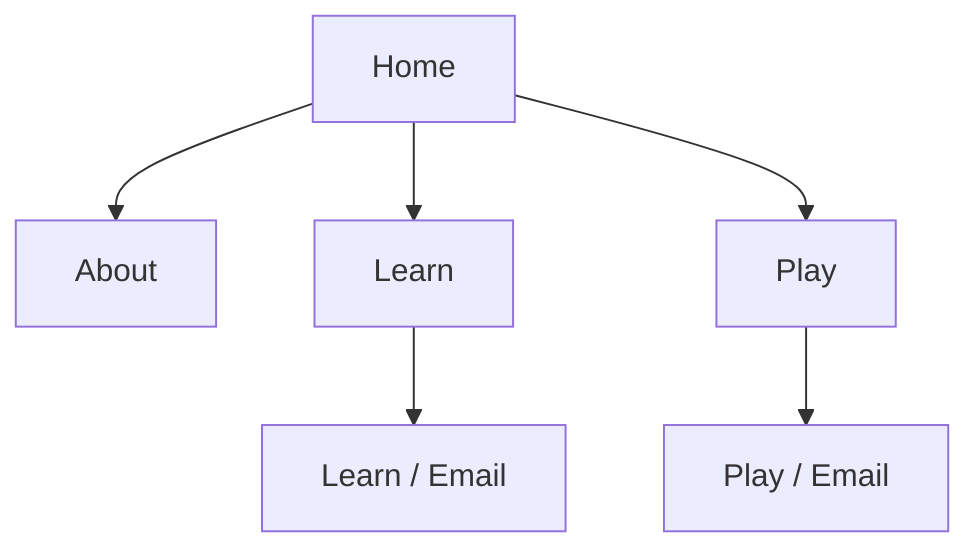
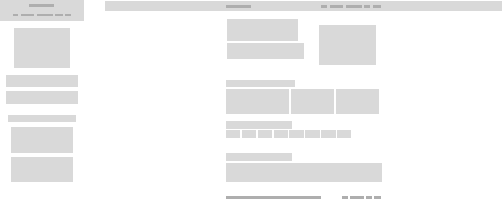
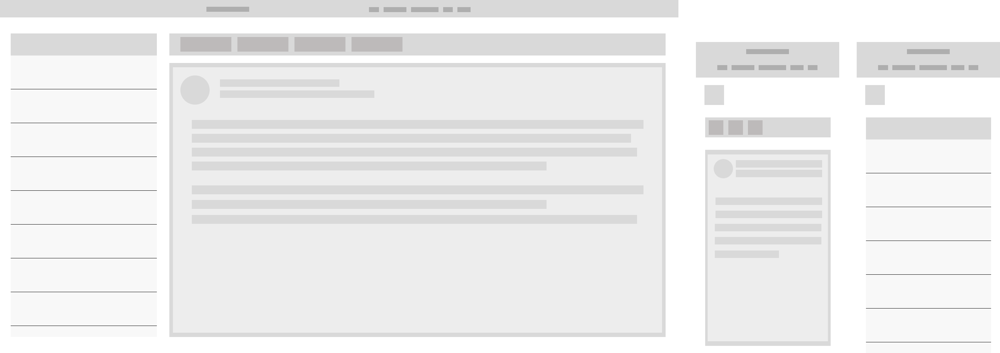

# Project Planning Document

| #   | Question - Yes, No, Why                                                                                                                                                                                                                                                                                                                                                                                                                                                                                                                                                                                                                                                                                                                                                               |
| --- | ------------------------------------------------------------------------------------------------------------------------------------------------------------------------------------------------------------------------------------------------------------------------------------------------------------------------------------------------------------------------------------------------------------------------------------------------------------------------------------------------------------------------------------------------------------------------------------------------------------------------------------------------------------------------------------------------------------------------------------------------------------------------------------- |
| 1   | **A real-world group of people has this problem, and I can talk to some of them.**<br><br>**Yes.** According to the Government of Canada, Canadians collectively lost over $704 million to fraud in 2025, with total losses since 2022 surpassing $2.4 billion. However, these figures represent only a fraction of the actual harm, as it is estimated that only 5% to 10% of fraud cases are reported.<br><br>[Government of Canada: Fraud Prevention Month](https://www.canada.ca/en/competition-bureau/news/2026/03/fraud-prevention-month-to-bring-hidden-crime-into-the-spotlight.html)                                                                                                                                                                                         |
| 2   | **Users do something in the app (not just read).**<br><br>**Yes.** Users will be able to play through scenarios that put their investigative knowledge of scam detection to the test. They will encounter both legitimate and illegitimate scenarios, with the difficulty gradually increasing as they progress through each scenario (emails, messages, phone calls, etc.).<br><br>Ideally, users will first learn how to recognize and avoid scams through the learning modules. They can then play through interactive scenarios to test how well they have retained that knowledge. We could optionally include a traditional quiz at the end of each learning module to provide a preliminary assessment of the user's knowledge. However, this feature is not necessary for V1. |
| 3   | **The app needs to remember things.**<br><br>**Yes.** The idea would be for users to have accounts on the website where they can track their progress, including which scenarios they've played and how they performed, instead of having to remember it themselves.<br><br>In the future, we could also introduce a system that tracks when users review the learning modules and recommends when they should play through the scenarios again to refresh their knowledge. However, this feature is not necessary for V1. Additionally, we could create a system that allows this information to be shared with, for example, a business using the website to train its employees. However, this is an optimistic future goal and is not something we are actively pursuing.         |
| 4   | **I can describe the first version in one sentence.**<br><br>**Yes.** Complete all essential pages, including Home, About, Learn, and Play, along with the game functionality for one scenario (in this case, email), which will also serve as a framework for developing all subsequent scenarios.                                                                                                                                                                                                                                                                                                                                                                                                                                                                                   |
| 5   | **I can picture at least three screens.**<br><br>**Yes.** We have already completed the home page, learn selection page, individual learn module pages, play selection page, email play page, and messaging play page, and the remaining scenarios will be based on their real-world counterparts, making them relatively easy to conceptualize.                                                                                                                                                                                                                                                                                                                                                                                                                                      |
| 6   | **I alone could build a simple first version.**<br><br>**Yes.** The central game structure is simple. We create the scenarios, identify what is suspicious about each email, and define whether the email is a scam or legitimate. I do not expect any major roadblocks with this process.                                                                                                                                                                                                                                                                                                                                                                                                                                                                                            |

**My one-sentence description of the first version:** Complete all essential pages, including Home, About, Learn, and Play, along with the game functionality for one scenario (in this case, email), which will also serve as a framework for developing all subsequent scenarios.

---

## Part 1: Define the Problem

### 1.1 Problem Statement

Every year, thousands of people fall victim to scams and phishing attacks, resulting in hundreds of millions of dollars in losses. Many people lack the knowledge and practical experience needed to recognize suspicious messages and identify common scam tactics, leaving them vulnerable to fraud.

### 1.2 Evidence from Real People

#### Conversation A

- **Who (Role):** TODO
- **Quote One:** TODO
- **Quote Two:** TODO
- **Surprise:** TODO

#### Conversation B

- **Who (Role):** TODO
- **Quote One:** TODO
- **Quote Two:** TODO
- **Surprise:** TODO

**Revised Problem Statement:** TODO (but expected NO CHANGE)

### 1.3 Persona

- **Name, Age / Life Stage, Role:** TODO
- **Context (when and where the problem happens):** TODO
- **Three Goals:** 1) TODO 2) TODO 3) TODO
- **Three Frustrations:** 1) TODO 2) TODO 3) TODO
- **Technology comfort and devices:** YOUR ANSWER HERE
- **A quote that sums them up:** "YOUR ANSWER HERE"

### 1.4 What Already Exists

| Alternative                                                                                                                                                                                                                                                                                                                                          | What it does well                                                                                                                                                  | Where it falls short for my persona |
| ---------------------------------------------------------------------------------------------------------------------------------------------------------------------------------------------------------------------------------------------------------------------------------------------------------------------------------------------------- | ------------------------------------------------------------------------------------------------------------------------------------------------------------------ | ----------------------------------- |
| Government educational resources (e.g., Canadian Centre for Cyber Security, Canadian Anti-Fraud Centre)<br><br>[Spotting malicious email messages](https://www.cyber.gc.ca/en/guidance/spotting-malicious-email-messages-itsap00100)<br>[Scams and fraud - Government of Canada](https://www.canada.ca/en/revenue-agency/campaigns/fraud-scams.html) | Provide reliable information about common scams, warning signs, and ways to protect yourself. The Cyber Centre has detailed guidance on spotting malicious emails. | TODO                                |
| Interactive scam-awareness games (e.g., [Common Sense Media's Click It or Skip It](https://www.commonsense.org/click-it-or-skip-it))                                                                                                                                                                                                                 | Allow users to practise deciding whether messages are safe or scams. The game is designed for students in grades 3-12.                                             | TODO                                |
| Manual investigation (searching online, asking someone, or relying on personal judgment)                                                                                                                                                                                                                                                             | Accessible and flexible. Users can investigate suspicious messages using online resources or seek advice from someone they trust.                                  | TODO                                |

### 1.5 Success Criteria

1. Users can correctly identify at least 80% of suspicious elements in the scenarios presented.
2. Users demonstrate improved ability to distinguish between legitimate and fraudulent messages after completing the learning modules.
3. Users can complete the available scenarios without assistance and receive immediate feedback explaining their mistakes.

### 1.6 Abstract

#### The Problem

According to the Government of Canada, Canadians [lost over $704 million to fraud in 2025](https://www.canada.ca/en/competition-bureau/news/2026/03/fraud-prevention-month-to-bring-hidden-crime-into-the-spotlight.html), with reported losses since 2022 surpassing $2.4 billion. These figures only represent an estimated 5% to 10% of fraud cases that are reported, suggesting that the actual losses could be substantially higher. In the United States, the FBI's 2025 Internet Crime Report shows that Americans [lost nearly $21 billion to fraud in the same year](https://www.fbi.gov/news/press-releases/cryptocurrency-and-ai-scams-bilk-americans-of-billions), with 1,008,597 complaints submitted to the Internet Crime Complaint Center that year.

Although some people may believe they are "beyond" being deceived, this problem affects everyone, both directly and indirectly. Fraud can lead to financial difficulties and significant distress, including stress, anxiety, panic, and depression. These consequences do not only affect the person who was defrauded, but can also affect those who depend on them, such as children whose parents have suffered financial loss.

#### The Purpose

ScamScan is a centralized, interactive platform where users can learn how to identify suspicious situations, whether they involve websites, emails, messages, investments, phone calls, or other forms of scams. Users will learn what warning signs to look for and then put their knowledge to the test through realistic, interactive scenarios that reflect how they might encounter scams in real life. ScamScan is similar to Duolingo, but instead of teaching languages, it teaches users how to recognize and avoid scams through interactive lessons and realistic scenarios.

#### Why It Matters

ScamScan matters because knowledge is the first and most important step in staying safe online. You cannot always rely on your browser to block a suspicious website, your email client to filter a phishing email, or your phone to identify a suspicious number. When these systems fail, knowing when to stop, reconsider, and question the legitimacy of something can prevent people from falling victim to scams.

Most scams do not rely on zero-day vulnerabilities or sophisticated technical exploits. Instead, they often rely on manipulating people into willingly providing information, sending money, or taking action under false pretences. By teaching people how to recognize these tactics, ScamScan aims to help them protect themselves even when automated security measures fail.

---

## Part 2: What to Build

### 2.1 Scope (MoSCoW)

| Feature                                                              | Group  | Because                                                                                                       |
| -------------------------------------------------------------------- | ------ | ------------------------------------------------------------------------------------------------------------- |
| Email scam identification game                                       | Must   | Because it provides the foundation for testing whether users can identify suspicious elements.                |
| Immediate feedback on user selections                                | Must   | Because users need to understand their mistakes and improve their ability to recognize scams.                 |
| Learn modules explaining common scam techniques                      | Must   | Because users need educational resources to improve their scam awareness.                                     |
| Scenario completion and scoring system                               | Must   | Because it allows users to measure their performance and evaluate their progress.                             |
| Legitimate and fraudulent email examples                             | Must   | Because users need to learn to distinguish between legitimate and fraudulent messages.                        |
| Text message scam scenarios                                          | Should | Because it expands scam awareness beyond email.                                                               |
| Additional scam categories (phone calls, job offers, listings, etc.) | Should | Because it exposes users to a wider variety of scams.                                                         |
| Progress tracking across scenarios                                   | Should | Because users can monitor their performance over time.                                                        |
| Difficulty levels                                                    | Could  | Because varying difficulty could provide a more challenging learning experience.                              |
| Randomized scenarios                                                 | Could  | Because it increases replayability and prevents users from memorizing answers.                                |
| User accounts and profiles                                           | Won't  | Because the first version can provide the core learning experience without requiring user registration.       |
| Online leaderboards                                                  | Won't  | Because comparing scores between users is not necessary to achieve the project's primary learning objectives. |
| Multiplayer functionality                                            | Won't  | Because the project focuses on individual scam awareness and education.                                       |
| AI-generated scam scenarios                                          | Won't  | Because manually created scenarios provide sufficient content for the initial release.                        |

### 2.2 Main User Flow

1. **Home Page:** The user visits ScamScan and is introduced to the website and its purpose.
2. **Play Selection Page:** The user selects a scam category they want to practise identifying.
3. **Game Page:** The user is presented with a realistic scenario, such as an email containing potentially suspicious elements.
4. **Game Page:** The user examines the scenario and selects the elements they believe are suspicious.
5. **Game Page:** The user submits their selections and receives immediate feedback explaining which elements they correctly or incorrectly identified.
6. **Results Page:** The user reviews their score and sees how well they performed in the scenario.
7. **Learn Page:** The user can visit educational modules to learn more about common scam techniques and how to recognize them.

### 2.3 Data Sketch

| Thing           | Details it remembers                                                                                        |
| --------------- | ----------------------------------------------------------------------------------------------------------- |
| User            | Username, email address, password hash, account creation date                                               |
| Scenario        | Scenario name, category (email, messages, phone calls, etc.), difficulty, scenario content, correct answers |
| Attempt         | User ID, scenario ID, score, answers submitted, completion date                                             |
| Learning Module | Module name, category, educational content, associated scenarios                                            |

**Relationships:**

- A user can complete multiple scenarios, with each attempt associated with one user.
- A scenario can have multiple attempts from different users.
- Each attempt belongs to one scenario and records the user's performance.
- A learning module can be associated with multiple scenarios, helping users practise what they have learned.

### 2.4 Page List

| Page               | Purpose                                                                  | Built in Milestone 1? |
| ------------------ | ------------------------------------------------------------------------ | --------------------- |
| Home               | Introduces ScamScan and explains its purpose.                            | Yes                   |
| About              | Explains the project, its goals, and its intended audience.              | Yes                   |
| Learn              | Displays available learning modules covering different types of scams.   | Yes                   |
| Learn Module       | Teaches users how to recognize specific types of scams and avoid them.   | Yes                   |
| Play               | Displays available interactive scenarios for users to complete.          | Yes                   |
| Email Scenario     | Allows users to practise identifying legitimate and fraudulent emails.   | Partial               |
| Messaging Scenario | Allows users to practise identifying legitimate and fraudulent messages. | No                    |
| User Registration  | Allows new users to create an account.                                   | No                    |
| Login              | Allows existing users to access their accounts.                          | No                    |
| User Dashboard     | Displays user progress, completed scenarios, and performance.            | No                    |

**Partial:** The Email Scenario page has its HTML and CSS completed, but its interactive game functionality has not yet been implemented.

### 2.5 GitHub Issues

1. Build the home page and the core page (HTML): https://github.com/...
2. Style the site: palette, responsive layout and components: https://github.com/...
3. Feature (Must): https://github.com/...
4. Feature (Must): https://github.com/...
5. Feature (Must): https://github.com/...

### 2.6 Abstract Check

**Changes Made:** No changes were necessary. The original abstract still accurately represents the project's goals, intended functionality, and scope. The Must-have features align with what was originally proposed.

---

## Part 3: Storyboard

> Four to six panels. The first shows the problem, the last shows it solved, and the same persona appears throughout. Save images in `design/storyboard/` and embed them below with ``.

| Panel | Scene (where, who) | What happens | What they think or feel | Screen shown |
| ----- | ------------------ | ------------ | ----------------------- | ------------ |
| 1     |                    |              |                         |              |
| 2     |                    |              |                         |              |
| 3     |                    |              |                         |              |
| 4     |                    |              |                         |              |

**My storyboard images:**

YOUR ANSWER HERE

---

## Part 4: Wireframes

### 4.1 Site Map



### 4.2 Wireframes

> Four images: Home and core page, each on a phone-width and a desktop-width screen. Real words, no colour. Embed them.

**Home, desktop and phone:**



**Core page, desktop and phone:**



For the ScamScan home page, you could annotate the main regions as follows:

### 4.3 Annotations

Home page

| Region                      | HTML element             | Why this element                                                                                       |
| --------------------------- | ------------------------ | ------------------------------------------------------------------------------------------------------ |
| Header / Navigation         | `<header>` and `<nav>`   | The header contains the site's branding, while the navigation provides links to the other pages.       |
| Main content / Introduction | `<main>` and `<section>` | Main contains the primary page content, while the section groups the introduction and welcome message. |
| Call-to-action buttons      | `<a>`                    | Links users to the Learn and Play pages, allowing them to navigate to the site's main features.        |

Core page (Email game)

| Region                    | HTML element             | Why this element                                                                                              |
| ------------------------- | ------------------------ | ------------------------------------------------------------------------------------------------------------- |
| Email navigation / Inbox  | `<aside>`                | Contains secondary content, such as the inbox and list of available emails, separate from the main game area. |
| Email content / Message   | `<main>` and `<article>` | Main contains the primary game content, while article represents the individual email being examined.         |
| Answer buttons / Controls | `<form>` and `<button>`  | Allows users to interact with the game by selecting suspicious elements or submitting their answers.          |

### 4.4 Five-second test

- **Who I tested (role only):** TODO
- **What they said the page is for, and what they would do first:** TODO
- **What I changed because of it (or why I changed nothing):** TODO

## Part 5: Design Decisions

### 5.1 Mood

- **Three words:** YOUR ANSWER HERE
- **Why they fit my persona:** YOUR ANSWER HERE

### 5.2 Palette

**Light Mode**

| Role                    | Variable              | Hex     | Tailwind Class |
| ----------------------- | --------------------- | ------- | -------------- |
| Page background         | `--color-bg`          | #FAFAF9 | stone-50       |
| Card and header surface | `--color-surface`     | #FFFFFF | white          |
| Body text               | `--color-text`        | #292524 | stone-800      |
| Headings and links      | `--color-primary`     | #1C1917 | stone-900      |
| Buttons and highlights  | `--color-accent`      | #EA580C | orange-600     |
| Button hover            | `--color-accent-dark` | #C2410C | orange-700     |
| Borders                 | `--color-border`      | #E7E5E4 | stone-200      |
| Secondary text          | `--color-muted`       | #78716C | stone-500      |

**Dark Mode**

| Role                    | Variable              | Hex     | Tailwind Class |
| ----------------------- | --------------------- | ------- | -------------- |
| Page background         | `--color-bg`          | #171615 | custom         |
| Card and header surface | `--color-surface`     | #201E1C | custom         |
| Body text               | `--color-text`        | #E7E5E4 | stone-200      |
| Headings and links      | `--color-primary`     | #FFFFFF | white          |
| Buttons and highlights  | `--color-accent`      | #F97316 | orange-500     |
| Button hover            | `--color-accent-dark` | #FB923C | orange-400     |
| Borders                 | `--color-border`      | #44403C | stone-700      |
| Secondary text          | `--color-muted`       | #A8A29E | stone-400      |

### 5.3 Contrast table

**Light Mode**

| Text colour | On      | What it is            | Ratio   | Passes? |
| ----------- | ------- | --------------------- | ------- | ------- |
| #292524     | #FAFAF9 | Body text on the page | 14.52:1 | Yes     |
| #1C1917     | #FFFFFF | Heading on a card     | 17.48:1 | Yes     |
| #FFFFFF     | #EA580C | Button text           | 3.55:1  | No      |
| #FFFFFF     | #C2410C | Button text on hover  | 5.17:1  | Yes     |
| #78716C     | #FFFFFF | Muted text on a card  | 4.79:1  | Yes     |
| #292524     | #FFFFFF | Body text on a card   | 15.16:1 | Yes     |

**Dark Mode**

| Text colour | On      | What it is            | Ratio   | Passes? |
| ----------- | ------- | --------------------- | ------- | ------- |
| #E7E5E4     | #171615 | Body text on the page | 14.39:1 | Yes     |
| #FFFFFF     | #201E1C | Heading on a card     | 16.61:1 | Yes     |
| #171615     | #F97316 | Button text           | 6.44:1  | Yes     |
| #FFFFFF     | #FB923C | Button text on hover  | 7.98:1  | Yes     |
| #A8A29E     | #201E1C | Muted text on a card  | 6.58:1  | Yes     |
| #E7E5E4     | #201E1C | Body text on a card   | 15.16:1 | Yes     |

### 5.4 Type and spacing

- **Heading font stack:** `ui-sans-serif, system-ui, sans-serif`
- **Body font stack:** `ui-sans-serif, system-ui, sans-serif`
- **Type scale (`h1`, `h2`, `h3`, body, in rem):** `3rem`, `2rem`, `1.5rem`, `1rem`
- **Spacing unit:** `0.25rem` (4px), following Tailwind's spacing scale.
- **Corner radius:** `0.5rem` (8px) for buttons and smaller elements; `1rem` (16px) for cards and larger containers.

### 5.5 Pace check

> Halfway through your time, run `git log --format='%ad' --date=short | sort -u | wc -l`. You need commits on at least four different days.

```text
(paste the number here)
```

---

## Part 6: Build the Structure (HTML)

For your ScamScan homepage, you could fill it out like this:

### 6.1 Build table

| Wireframe region              | Element in my HTML          | File                     |
| ----------------------------- | --------------------------- | ------------------------ |
| Header / navigation           | `<header>`                  | `components/header.html` |
| Hero section                  | `<section>`                 | `index.html`             |
| Hero heading and description  | `<h2>`, `<p>`               | `index.html`             |
| Primary and secondary buttons | `<a>`                       | `index.html`             |
| Category lists                | `<section>`, `<ul>`, `<li>` | `index.html`             |
| How it works                  | `<section>`, `<ol>`, `<li>` | `index.html`             |
| Footer                        | `<footer>`                  | `components/footer.html` |

### 6.2 Checks

- [ ] Both pages have exactly one `h1` and headings in order
- [ ] Both pages have the viewport meta tag and a unique `<title>`
- [ ] The `nav` links to both pages and marks the current one with `class="active"`
- [ ] There is a list of repeated items, each an `article`
- [ ] The form has a `label`, `id` and `name` for every control
- [ ] Informative images have real alt text and decorative ones use `alt=""`
- [ ] No lorem ipsum anywhere
- [ ] I used at least one absolute, one relative and one same-page link

### 6.3 Validator results

- **Home page:** screenshot `screenshots/home-validation.png`
- **Core page:** screenshot `screenshots/core-validation.png`

**Errors I met and fixed (at least one):** YOUR ANSWER HERE

---

## Part 7: Style It (CSS)

### 7.1 Match table

> Compare the finished pages with your wireframes.

| Page      | What matches | What changed, and why |
| --------- | ------------ | --------------------- |
| Home      |              |                       |
| Core page |              |                       |

### 7.2 Checks

- [ ] Every colour, font, spacing and radius comes from `:root`
- [ ] No `!important`, no inline `style`
- [ ] Mobile first, with at least two `min-width` media queries
- [ ] Flexbox is used for the header and nav, and Grid for the cards
- [ ] `.btn` and `.card` (or my own reusable classes) are used everywhere
- [ ] There is no sideways page scroll at 375px
- [ ] The page still looks decent with Google Fonts blocked

### 7.3 Contrast re-check

**Pairs I re-tested on the built page, and any I had to change:** YOUR ANSWER HERE

### 7.4 CSS validator

**What the W3C CSS Validator said (and whether any warning matters):** YOUR ANSWER HERE

### 7.5 Screenshots

> Embed them: `screenshots/home-375.png`, `screenshots/home-1280.png`, `screenshots/core-375.png`, `screenshots/core-1280.png`.

YOUR ANSWER HERE

---

## Part 8: Git and GitHub

**Repository:** https://github.com/...
**Issue #1 (closed):** https://github.com/...
**Issue #2 (closed):** https://github.com/...
**Merged Pull Request for HTML:** https://github.com/...
**Merged Pull Request for CSS:** https://github.com/...
**Release v0.1.0:** https://github.com/...

```text
(git log --oneline | wc -l)
```

```text
(git log --format='%ad' --date=short | sort -u | wc -l)
```

```text
(git branch -a)
```

```text
(git log --oneline --graph --all | head -20)
```

---

## Part 9: Reflection

> Two to four sentences each, about your own project.

1. **From idea to problem:** YOUR ANSWER HERE
2. **Evidence:** YOUR ANSWER HERE
3. **The hardest decision:** YOUR ANSWER HERE
4. **Design to code:** YOUR ANSWER HERE
5. **Risks for the next milestones:** YOUR ANSWER HERE
6. **Tools (including any AI tool, and what I did myself):** YOUR ANSWER HERE

### Self-assessment

| Area                            | Points | My score | One line of justification |
| ------------------------------- | ------ | -------- | ------------------------- |
| Problem definition and evidence | 15     |          |                           |
| Scope and data                  | 10     |          |                           |
| Storyboard                      | 10     |          |                           |
| Wireframes and site map         | 10     |          |                           |
| Design decisions                | 5      |          |                           |
| HTML                            | 15     |          |                           |
| CSS and responsiveness          | 15     |          |                           |
| Git and GitHub                  | 15     |          |                           |
| Reflection and completeness     | 5      |          |                           |

## Bonus (optional)

- **Usability test (+3):** who I tested (roles), what happened, what I changed: YOUR ANSWER HERE
- **Live site (+2):** https://...
